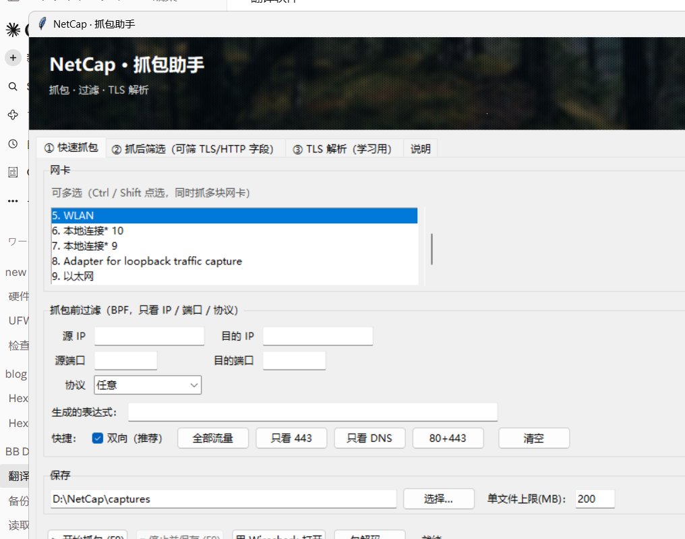

# NetCap · 抓包助手

> 给 Wireshark 套一个中文壳：**一键起停抓包、按网卡分别设过滤、事后按域名/SNI 筛完整会话、单包解码看全部头部**。
> A lightweight Chinese GUI wrapper for Wireshark's `dumpcap`/`tshark`, with per-NIC capture filters,
> post-capture stream export, TLS handshake parsing, and a three-pane packet decoder.



**English TL;DR** — NetCap drives `dumpcap`/`tshark` from a Tkinter GUI. You pick one or more NICs,
write a BPF filter (or use the quick buttons), capture, then afterwards filter by HTTP host / SNI /
TLS version and export **whole TCP streams** into a new pcap. A separate window decodes a single packet
(MAC → IP → TCP → TLS/HTTP) with a hex dump and highlighted key fields. No API keys, no telemetry,
everything runs locally.

**环境要求**：Windows + Python 3.10+（自带 tkinter）+ [Wireshark](https://www.wireshark.org/)（提供 dumpcap/tshark）。
本工具本身**不需要 pip 安装任何依赖**。

## 已知问题与修复记录

| 现象 | 原因 | 修复 |
|---|---|---|
| 抓包启动后立刻失败、没有文件 | `dumpcap -b filesize` 会把输出改名成 `base_00001_时间戳`，程序按原文件名找不到 | 去掉 `-b`，改成程序内部监控文件大小、超限自动停 |
| 停止时报 `句柄无效` | GUI 进程没有控制台，`CTRL_BREAK` 送不到子进程 | 停止统一用 `terminate`（实测 pcapng 仍可读） |
| 某些目录报 `Permission denied` | dumpcap 直接创建文件受目录 ACL 影响 | 改成 `dumpcap -w -` 输出到管道，**由程序自己写文件**；仍失败则自动降级到 `%USERPROFILE%\NetCap\captures` |
| F9 不灵 / 连按两次 | 绑定在 root 上，焦点在输入框时收不到；且按键连发 | 改 `bind_all` + 400ms 防抖 |

| 每次启动都要管理员、还会弹黑框 | 右键「以管理员身份运行」会在注册表留下兼容性标记 `RUNASADMIN`，导致永久提权 | 删掉 `HKCU\Software\Microsoft\Windows NT\CurrentVersion\AppCompatFlags\Layers` 里对应项；子进程加 `CREATE_NO_WINDOW` |

> 注意：F9 是**程序内热键**，窗口失去焦点时不响应（需要的是系统级全局热键，另说）。

## 包解码（单包详情）

主界面点「**包解码…**」打开一个新窗口（比 Wireshark 的三窗格更适合逐包细看）：

```
┌──────────────────────────────┬───────────────────────────┐
│ 抓包信息（所有包，可筛选/跳转） │  该包全部头信息            │
│                              │                           │
├──────────────────────────────┤  关键信息速览（红字）      │
│ 16 进制（默认折叠 24 行）     │  二层 MAC / 三层 IP /     │
│                              │  四层端口 / TLS SNI …     │
└──────────────────────────────┴───────────────────────────┘
```

**操作**：

| 动作 | 效果 |
|---|---|
| 点列表任意一行 | 右边显示该包的完整字段树 |
| 「过滤」框 + 应用 | 只列出匹配的包（显示过滤器语法） |
| 「跳到帧」+ 回车 | 直接定位到指定帧号 |
| 「展开全部 / 折叠」 | 16 进制区切换全部/前 24 行 |
| 「显示帧元信息」 | 勾选后额外显示 frame/geninfo 层 |

**右边展示什么**：按协议栈从下往上展开，每一层都列出 tshark 能解析的**全部字段**
（链路层 MAC、EtherType、IP 各字段、TCP 标志位与序号、TLS 握手扩展、HTTP 头…），
关键字段用**红色加粗**标出。

## 顶部背景

程序顶部有一条横幅，可在「说明」页底部切换：

| 选项 | 风格 |
|---|---|
| **nc2 · 森林**（默认） | 深绿，最稳 |
| nc1 · 淡雅水波 | 浅灰白，干净 |
| nc3 · 街景 | 中性灰蓝 |
| nc4 · 仙人掌 | 深绿带红点 |
| （无） | 纯色，最省 |

选完点「应用」立即生效，并记进 `netcap_config.json`。

> 图片来自 [picsum.photos](https://picsum.photos)（Unsplash 免费图库），
> 已做轻微模糊 + 压暗处理，保证白色标题清晰、不喧宾夺主。

## 快速开始

```
双击  NetCap.exe         ← 推荐（已打包，无需 Python）
或    启动NetCap.bat      ← 有 exe 时优先调用 exe
或    python netcap.py    ← 源码方式
```

前置：本机已装 Wireshark（默认找 `E:\wireshark`，也自动找 `C:\Program Files\Wireshark` 等）。
首次运行会在 `D:\NetCap\captures` 建目录存 pcapng。

> **exe 说明**：目录模式（onedir），`NetCap.exe` 必须和 `_internal\` 文件夹放在一起，
> 不能只拷 exe。优点：启动快（约 2~3 秒）、不依赖临时目录解压。
>
> 为什么不用单文件（onefile）：实测在**带空格的路径**（如 `E:\BB Down\...`）下，
> PyInstaller 单文件会报 "Could not create temporary directory"，目录模式没有这个问题。


## 引导式完整流程（推荐用法）

```
① 快速抓包页：填目的端口 443 → 点「开始抓包（F9）」
② 去浏览器操作
③ 点「停止并保存（F9）」
     ↓
   ┌─────────────────────────────────────────┐
   │ 抓包完成 ✅                              │
   │ 文件：netcap_20261107_112000.pcapng      │
   │ 包数：1,284 个                           │
   │ 是否继续设置【后置过滤条件】？             │
   │              [是]  [否]                  │
   └─────────────────────────────────────────┘
     ↓ 是                              ↓ 否
   中文表单填 TLS/HTTP 条件          直接问是否打开
     ↓
   [预览命中结果] [生成成品 pcap] [跳过]
     ↓
   成品 = netcap_xxx_final.pcapng（前后过滤都生效）
     ↓
   ┌─────────────────────────────────────────┐
   │ 成品已生成：netcap_xxx_final.pcapng      │
   │ 共 216 个包                              │
   │ 现在用 Wireshark 打开吗？ [是] [否]       │
   └─────────────────────────────────────────┘
```

**按钮「用 Wireshark 打开」**：优先打开成品（`_final`），没有成品时打开原始抓包文件。

## 界面三页

### ① 快速抓包

**网卡可以多选**（Ctrl / Shift 点选）。多选后点「开始抓包」会先弹一个窗口，
**让你为每块网卡单独写 BPF**：

```
5. WLAN          [tcp port 443      ]
8. Loopback      [tcp port 10808    ]
```

留空 = 那块卡不过滤。确定后：

- 每块网卡起一个 dumpcap 进程（各自的过滤条件互不干扰）
- 各写一个 `xxx_if5.pcapng` / `xxx_if8.pcapng`
- 停止时用 `mergecap` 合并成 `xxx_merged.pcapng`（接口信息保留）

> 为什么不能用一个进程多个 `-i`？因为 dumpcap 的 `-f` 是**全局**的，
> 一块卡一个条件就得分进程；合并后时间戳来自同一台主机，顺序不会乱。

停止后做后置过滤时，对话框里会多一个「**限定网卡**」下拉——
多网卡合并文件可以只筛某一块卡的报文。


| 元素 | 说明 |
|---|---|
| 网卡 | 自动列出（默认选 WLAN） |
| 源/目的 IP、源/目的端口、协议 | 生成 BPF 抓包过滤器 |
| 生成的表达式 | 实时显示，可手动改 |
| 快捷按钮 | 全部流量 / 只看 443 / 只看 DNS / 80+443 / 清空 |
| 保存目录、单文件上限 | 环形缓冲，默认 200 MB 防爆盘 |
| **开始抓包（F9）** | 点一下就开始，随时再按 F9 停 |
| **停止并保存** | 自动统计包数，问你要不要用 Wireshark 打开 |

**时序问题的解法**：抓包是**先开着**的，你什么时候点网页都行；停下来之后整段都在文件里。

### ② 抓后筛选（能筛 TLS / HTTP 字段）

选一个 pcapng，用中文表单配条件：

| 字段 | 例子 |
|---|---|
| 协议 | HTTP / HTTP2 / HTTPS-TLS / DNS |
| HTTP 方法 | GET / POST |
| 状态码 | 200 / 404 |
| 域名 / SNI 含 | bilibili |
| TLS 版本 | TLS1.2 / TLS1.3 |
| 端口 / IP | 443 / 1.1.1.1 |
| 内容包含 | 某段明文（仅明文协议有效） |

→ 生成 Wireshark 显示过滤器 → **预览结果** 或 **导出为新 pcap 并打开**。

**多网卡合并文件**：对话框左边多一个网卡列表，**每块网卡分别配条件**（● 表示已配）。
底部可选导出方式：

| 方式 | 结果 |
|---|---|
| **合并成一个文件**（默认） | 一条 `(ifaceA && condA) \|\| (ifaceB && condB)` 表达式一次导出，时间戳原样保留 |
| **每块网卡分别导出** | `xxx_final_if1.pcapng` / `xxx_final_if2.pcapng` 各一份 |

> 合并导出不用重新排序：原文件本身就是时间序，过滤只是挑选，顺序天然保持。
> 真正物理合并多个文件用的是 `mergecap`，它按时间戳归并。

### ③ 说明

内置了常用表达式对照表。

## ⚠️ 为什么「抓包前过滤」不能筛 TLS 字段

这是 libpcap/BPF 的固有限制，不是本工具偷懒：

```
抓包那一刻 → 报文还没解析 → 只有 IP / 端口 / 协议头
            TLS 的 SNI、版本、HTTP 的方法状态码 都不存在
```

所以分两段：

```
抓包前（BPF）      → 粗筛：IP / 端口 / 协议，减少文件体积
抓后（显示过滤器）  → 精筛：TLS / HTTP 字段，在已保存的文件上做
```

本工具两段都做了，用中文表单把两边串起来。

## ③ TLS 解析（学习用）

选抓包文件 → 两个按钮：

| 按钮 | 输出 |
|---|---|
| **解析握手摘要** | 每个握手包一行：类型、SNI、ALPN、支持版本、密码套件、密钥交换组、扩展清单（带名称） |
| **解析扩展明细** | 把**每个扩展拆开**：type/len + 内部字段（supported_versions、compress_certificate、ECH、ALPS…） |

### 解密加密的扩展（TLS 1.3）

TLS 1.3 的 `EncryptedExtensions` / `Certificate` / `Finished` 都是加密的，
默认只能看到 ClientHello 的扩展。要看解密后的内容：

1. 设环境变量后**重启浏览器**：

```powershell
setx SSLKEYLOGFILE "D:\sslkeys.log"
```

2. 正常访问网页（浏览器会把会话密钥写进该文件）
3. 在 NetCap 的「解密用 Keylog」里选 `D:\sslkeys.log`
4. 点「解析扩展明细」→ 加密扩展会显示明文字段

> 只能解密**自己这台机器、自己这个浏览器**的流量；别人的流量解不了。
> keylog 文件包含密钥，别外传。

## 常用过滤器对照（可直接贴进 Wireshark）

```
tcp.port == 443                          只留 443
tls.handshake.type == 1                  只看 Client Hello
tls.handshake.extensions_server_name contains "bilibili"
tls.record.version == 0x0304             TLS 1.3
http.request.method == "POST"
http.response.code >= 400                只看错误
dns.qry.name contains "example"
ip.addr == 1.1.1.1
frame contains "keyword"                 任意位置含关键字
```

## 能看到什么 / 看不到什么

| 能看到 | 看不到 |
|---|---|
| 连了哪些域名（SNI） | HTTPS 正文（TLS 加密） |
| TLS 版本、握手过程 | 密码、Cookie 值 |
| HTTP/1.1 的明文头（若有） | HTTP/2 的正文 |
| 包大小、时间、重传、RTT | 应用层业务数据 |

**要看 HTTPS 明文**：需要让浏览器导出 TLS 密钥（`SSLKEYLOGFILE` 环境变量），
再用 Wireshark 的 `(Pre)-Master-Secret log filename` 加载。这个属于进阶用法，
本工具暂不自动配置。

## 文件位置

```
netcap.py              主程序（tkinter，无第三方依赖）
启动NetCap.bat          无控制台启动
netcap_config.json     自动生成：Wireshark 路径、保存目录、上限
D:\NetCap\captures\    抓包文件默认存放处
```

## 自检

```
python netcap.py --selftest
```

会依次验证：找 Wireshark、列网卡、抓 3 秒、统计包数、生成过滤器、筛选导出。
